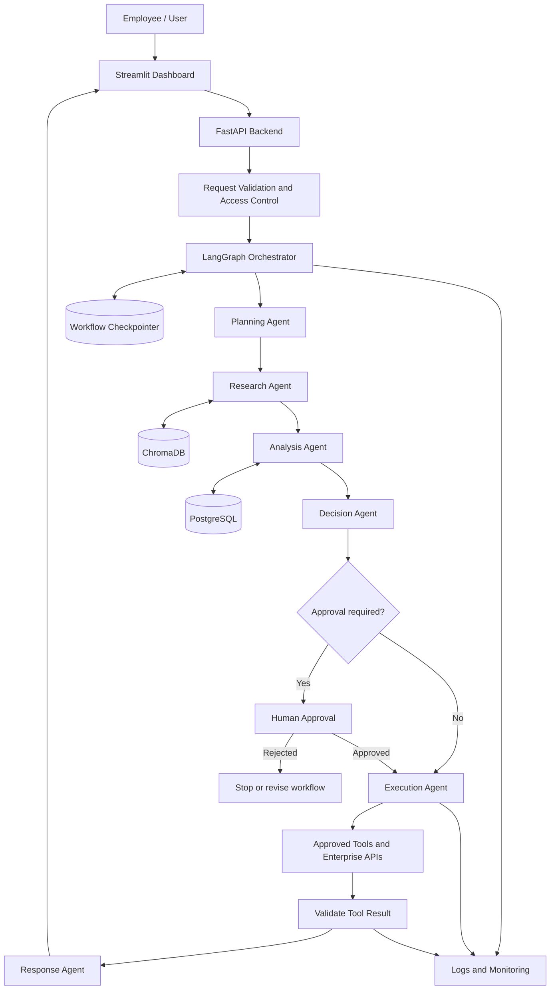

# System Architecture
## Development of Enterprise Workflow Platform with Decision Automation

**Document status:** Proposed architecture for project implementation  
**Note:** This is a design proposal. Confirm exact requirements and integrations with the project supervisor before implementation.

## 1. Purpose

The proposed platform automates enterprise workflows by coordinating specialized AI agents. It accepts a business request, plans the required work, gathers relevant information, analyses results, recommends a decision, and executes approved actions through configured tools or APIs.

## 2. Architectural principles

- **Modular:** UI, API, orchestration, agents, tools, and data storage are separate components.
- **Orchestrated:** A central workflow controller determines which agent runs and when.
- **Auditable:** Important decisions, approvals, tool calls, and outcomes are recorded.
- **Human-supervised:** Sensitive or irreversible actions require explicit approval.
- **Replaceable:** LLM providers, databases, and external tools can be swapped without redesigning the whole platform.
- **Secure by default:** Credentials are stored outside source code; tools enforce permissions and validate inputs.

## 3. Proposed architecture layers

| Layer | Proposed technology | Responsibility |
|---|---|---|
| User interface | Streamlit | Submit requests and display status, recommendations, and reports |
| API | FastAPI | REST endpoints, request validation, and integration boundary |
| Orchestration | LangGraph | Workflow state, routing, conditional transitions, and checkpoints |
| Agent services | Python modules / LangChain | Specialized planning, research, analysis, decision, execution, and response tasks |
| LLM provider | Gemini API initially; provider abstraction | Language understanding, planning, summarization, and structured output |
| Retrieval | Sentence Transformers + ChromaDB | Search approved documents using semantic similarity |
| Relational storage | SQLite for prototype; PostgreSQL for deployment | Users, workflow records, structured results, and audit data |
| Monitoring | Python logging and dashboard metrics | Errors, execution history, latency, and workflow outcomes |

## 4. Architecture diagram



## 5. Agent responsibilities

| Agent / component | Responsibility | Expected output |
|---|---|---|
| Orchestrator | Owns workflow state, routes tasks, applies limits, handles retries and approval gates | Updated workflow state |
| Planning Agent | Interprets request and decomposes it into tasks | Structured plan |
| Research Agent | Retrieves relevant facts from approved documents, databases, or APIs | Findings with source references |
| Analysis Agent | Performs calculations, comparisons, and data analysis | Metrics and findings |
| Decision Agent | Applies business rules and evaluates alternatives | Recommendation with rationale |
| Execution Agent | Calls permitted tools and validates their results | Execution result and status |
| Response Agent | Produces a concise summary for the user | Final report |

Agents should have narrow responsibilities and validated input/output schemas. The orchestrator, not a free-running LLM, controls permissions and workflow transitions.

## 6. Workflow lifecycle

1. User submits a business request through the dashboard.
2. FastAPI validates the request and checks access permissions.
3. The orchestrator creates a workflow record and passes the request to the Planning Agent.
4. The Research Agent retrieves relevant information from authorized sources.
5. The Analysis Agent processes the information and computes required metrics.
6. The Decision Agent evaluates options using deterministic rules or scoring methods.
7. The orchestrator pauses for human approval when the action requires it.
8. The Execution Agent invokes the approved tool or API.
9. The system validates the tool result and records an audit event.
10. The Response Agent returns the result; workflow state is persisted.

## 7. Shared workflow state

A typed state object should carry only the information needed by the workflow. A simplified example:

```python
state = {
    "request_id": "",
    "user_request": "",
    "plan": [],
    "research_results": [],
    "analysis_results": {},
    "decision": {},
    "approval_status": "not_required",
    "execution_results": [],
    "final_response": "",
    "errors": []
}
```

Validate every model-generated structured response before using it as state or as a tool argument.

## 8. Memory and data architecture

### Short-term memory
- Current request and relevant conversation context.
- Active workflow state and completed steps.
- Intermediate outputs and pending approvals.

**Proposal:** LangGraph checkpointing. SQLite can be used for local development; choose a supported persistent backend for deployment.

### Long-term knowledge
- Approved enterprise documents and policies.
- Document metadata and embeddings.
- Reusable workflow summaries, subject to retention and access policies.

**Proposal:** ChromaDB for vector retrieval and PostgreSQL for structured records. Do not store passwords, API keys, or unnecessary sensitive data in agent memory.

## 9. Tool integration and safety

Each tool adapter should define an input schema, permission requirements, timeout, retry policy, and standard result format.

Required controls:
- Allowlist approved tools and API destinations.
- Validate and sanitize all tool arguments.
- Enforce user permissions on the backend.
- Use bounded retries, timeouts, and idempotency controls where appropriate.
- Require human approval for consequential or irreversible actions.
- Store credentials in environment variables or a secrets manager.
- Record user, workflow ID, tool name, timestamp, approval, and outcome.
- Treat retrieved documents and tool output as untrusted data, not as instructions that override system policy.

## 10. Suggested repository structure

```text
project-root/
├── README.md
├── docs/
│   ├── Architecture.md
│   └── Model_Research.md
├── app/
│   ├── api/
│   ├── agents/
│   ├── orchestration/
│   ├── tools/
│   ├── memory/
│   └── services/
├── tests/
├── requirements.txt
└── .env.example
```

This is a suggested structure; adapt it to the repository's existing layout rather than duplicating folders.

## 11. Implementation phases

| Phase | Work | Deliverable |
|---|---|---|
| 1 | Set up Python environment and connect one LLM | Basic model call |
| 2 | Implement agent roles and schemas | Individual agent modules |
| 3 | Add orchestration and shared state | End-to-end multi-agent workflow |
| 4 | Add retrieval and persistence | Document search and workflow memory |
| 5 | Add decision rules and approval gates | Governed decision workflow |
| 6 | Build API and dashboard | Usable application |
| 7 | Add tests, logs, security, and deployment | Evaluated prototype |

## 12. Evaluation

Measure end-to-end task completion, output correctness, retrieval relevance, tool selection and argument validity, decision quality, latency, retry rate, and cost per workflow. Use a fixed test set and record model and prompt versions so results are reproducible.

## 13. References

- [LangGraph documentation](https://docs.langchain.com/oss/python/langgraph/overview)
- [LangChain documentation](https://docs.langchain.com/oss/python/langchain/overview)
- [FastAPI documentation](https://fastapi.tiangolo.com/)
- [Streamlit documentation](https://docs.streamlit.io/)
- [Chroma documentation](https://docs.trychroma.com/)
- [PostgreSQL documentation](https://www.postgresql.org/docs/)

## 14. Conclusion

The proposed architecture separates user interaction, API handling, agent orchestration, model access, retrieval, persistence, and tool execution. This separation supports maintainability, controlled execution, and future replacement of individual components. Validate the design against the final project requirements before implementation.
